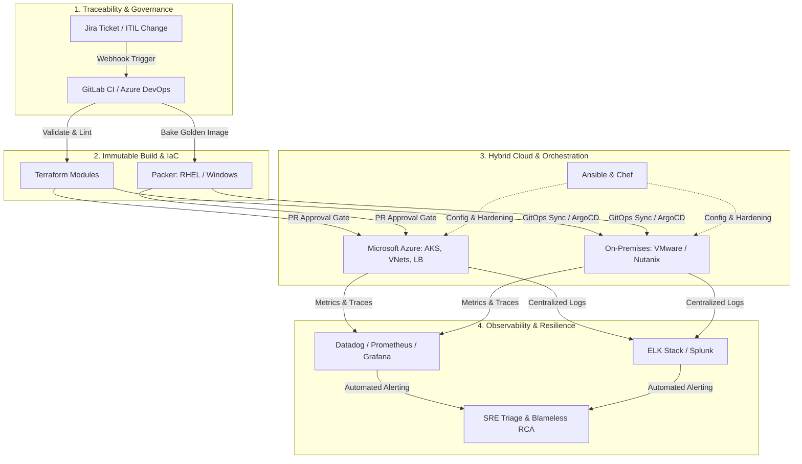
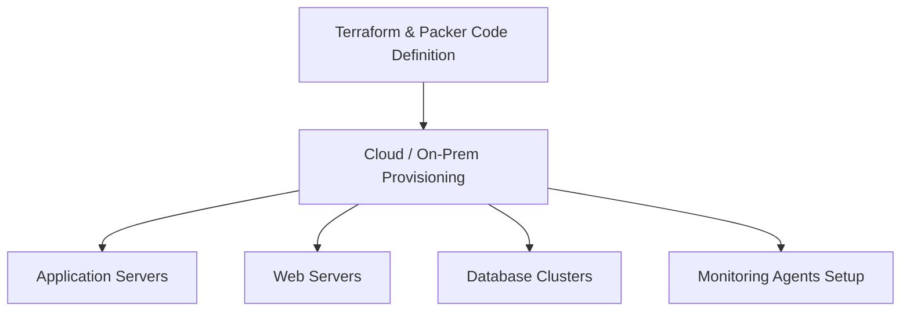
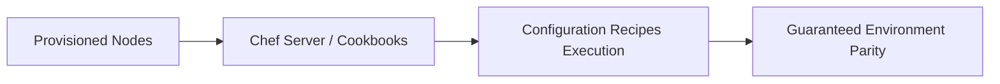
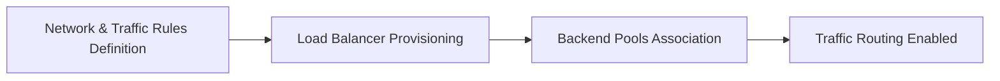
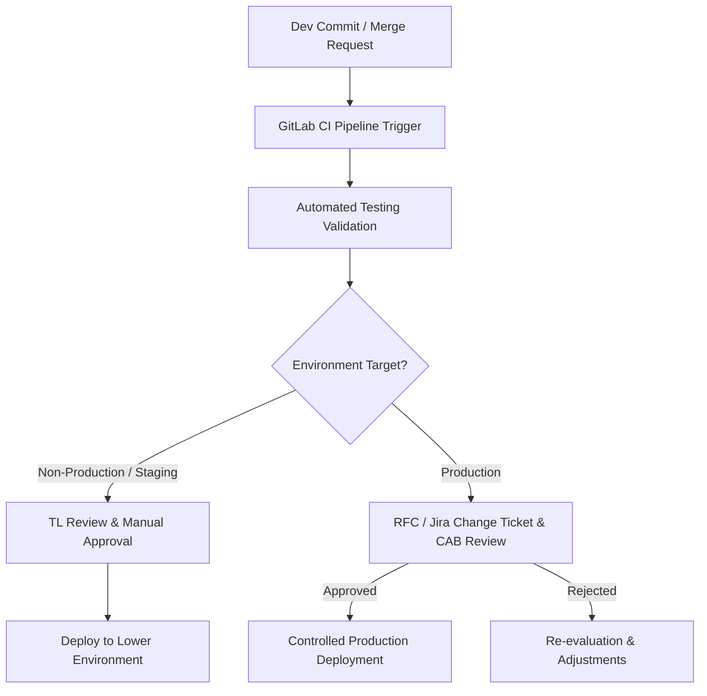
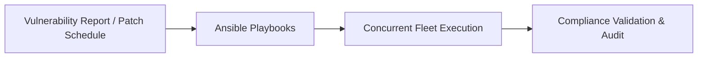
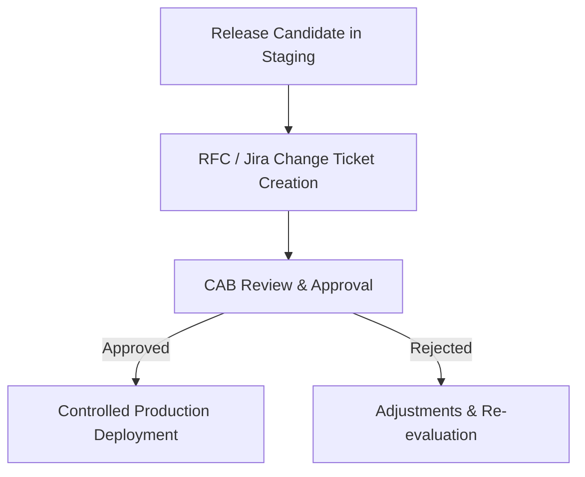
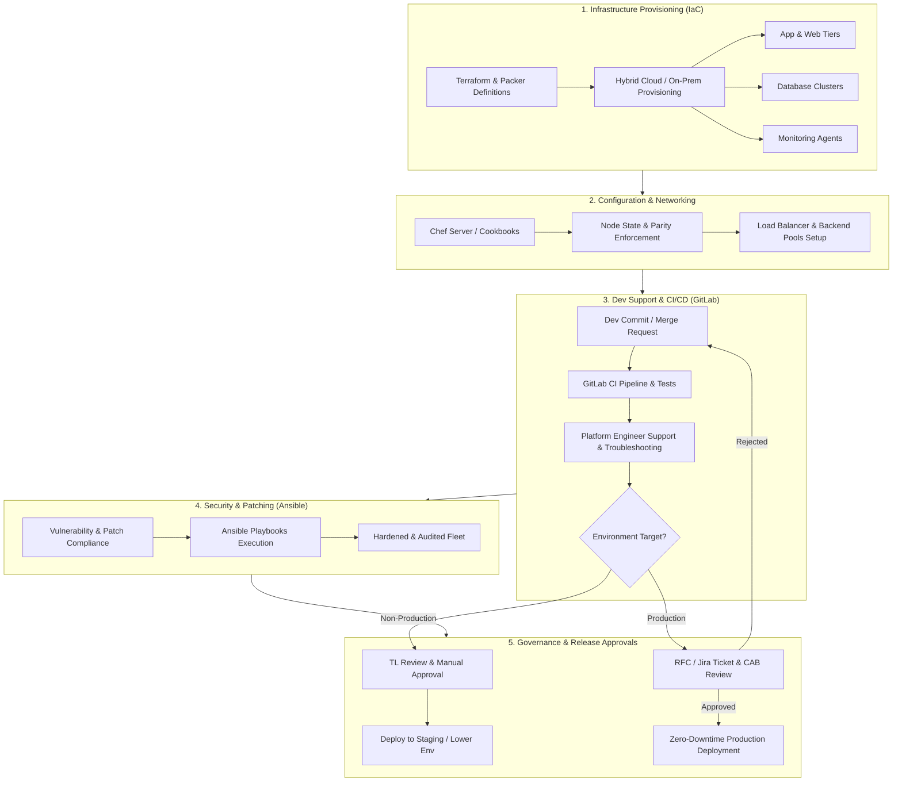

# Erick Pinango
**Technical Lead | Site Reliability Engineer (SRE) | Platform & DevOps Engineer**  
📍 Burnaby, BC, Canada • [LinkedIn](https://www.linkedin.com/in/erick-johan-pinango-garcia-9bb49a12a) • [GitHub](https://github.com/ejpinangog) • [ejpinangog@gmail.com](mailto:ejpinangog@gmail.com)

---

## Executive Summary

Technical Lead, SRE, DevOps and Platform Engineer with **over 10 years of experience** engineering fault-tolerant, scalable hybrid-cloud infrastructures within regulated enterprise environments. Expert in immutable infrastructure, automated Kubernetes platforms, and full-stack telemetry. Bridges deep system-level root cause analysis with proactive technical mentorship to eradicate manual toil, streamline CI/CD pipelines, and elevate engineering velocity.

### Key Production Impact

| Metric | Impact | Domain & Tooling |
| :--- | :--- | :--- |
| **99% Faster Provisioning** | Reduced server deployment lead times from days to minutes across 300+ multi-tier nodes | Terraform, Packer, GitLab CI |
| **80% Toil Reduction** | Automated user/SSH lifecycle, SSL/TLS rotation, OS patching, and DST audits across 2,000+ servers | Ansible, Chef, PowerShell, Bash |
| **>30% Cloud Cost Savings** | Implemented FinOps governance, automated non-prod shutdown schedules, and resource right-sizing | Microsoft Azure, Docker |
| **>50% Fewer Repeat Incidents** | Established proactive telemetry, tuned actionable alerting, and led blameless RCA postmortems | Datadog, Prometheus, ELK, Splunk |
| **Sub-Minute Recovery (RTO)** | Architected multi-zone high availability architectures and automated failover pipelines | VMware, Azure (Availability Zones), Nutanix |
| **Zero-Downtime Releases** | Migrated legacy monolithic workloads to containerized architectures with continuous rolling updates | Docker, Kubernetes, ArgoCD |

---

## Hybrid Cloud & GitOps Reference Architecture

### 1. Infrastructure Provisioning (App, Web, Database, Monitoring)

### 2. Server Configuration Management with Chef

### 3. Load Balancer (LB) Creation & Routing

### 4. Dev Team Support & GitLab CI Deployments

### 5. Patch & Vulnerability Management with Ansible

### 6. Production Deployment with CAB Approval

### End-to-End Platform Engineering & Delivery Lifecycle
### End-to-End Platform Engineering & Delivery Lifecycle

