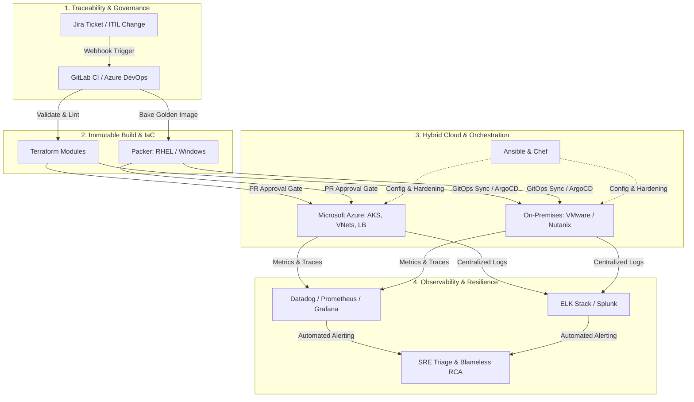

# Erick Pinango
**Technical Lead | Site Reliability Engineer (SRE) | Platform & DevOps Engineer**  
📍 Burnaby, BC, Canada • [LinkedIn](https://www.linkedin.com/in/ejpinangog) • [GitHub](https://github.com/ejpinangog) • [ejpinangog@gmail.com](mailto:ejpinangog@gmail.com)

---

## Executive Summary

Technical Lead and Platform/SRE Engineer with **over 10 years of hands-on experience** architecting, automating, and scaling mission-critical enterprise infrastructures across **hybrid cloud environments** (Microsoft Azure, Oracle Cloud, VMware vSphere, and Nutanix HCI). Specialized in replacing manual operational toil with declarative Infrastructure as Code (IaC), immutable golden images, and zero-downtime GitOps delivery pipelines under strict financial regulatory frameworks.

### Key Production Impact

| Metric | Impact | Domain & Tooling |
| :--- | :--- | :--- |
| **99% Faster Provisioning** | Reduced server deployment lead times from days to minutes across 300+ multi-tier nodes | Terraform, Packer, GitLab CI |
| **80% Toil Reduction** | Automated user/SSH lifecycle, SSL/TLS rotation, OS patching, and DST audits across 2,000+ servers | Ansible, Chef, PowerShell, Bash |
| **>30% Cloud Cost Savings** | Implemented FinOps governance, automated non-prod shutdown schedules, and resource right-sizing | Microsoft Azure, Docker |
| **>50% Fewer Repeat Incidents** | Established proactive telemetry, tuned actionable alerting, and led blameless RCA postmortems | Datadog, Prometheus, ELK, Splunk |

---

## Hybrid Cloud & GitOps Reference Architecture

